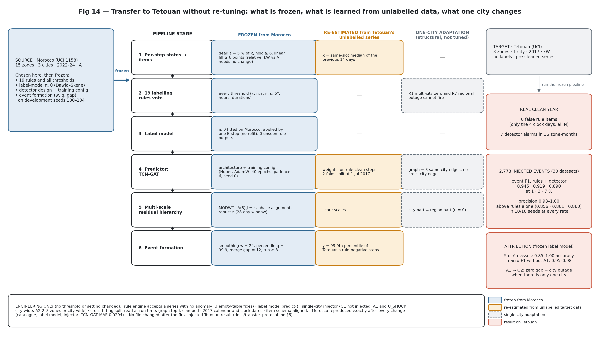

# Grid event or data artefact?

*Hierarchical weak supervision for anomaly attribution in multi-city feeder telemetry.*

Utilities often clean feeder telemetry without knowing what the anomalies are. Zeros and flat lines get deleted or interpolated whether they record a real outage or a data failure. This project uses the grid's own hierarchy (zone → city → region → data logger) to tell **grid events** (keep and flag) from **data artefacts** (impute), with no manual labels.

The output is a typed, probabilistic event catalogue for the UCI Morocco smart-meter dataset (id 1158). The catalogue is evaluated on injected events and on a downstream forecasting task.

**Status (2026-11-10):**
- **The analysis is complete:** rule engine, label model, detector, end model, injection benchmark (NB4), downstream test (NB5), transfer to Tetouan (NB6), and final figures, tables and the released catalogue (NB7).
- **Next:** writing the paper. The figure numbering, draft captions and every table are in [results/paper/MANIFEST.md](results/paper/MANIFEST.md).

## The method in one picture

```
raw feeder series (15 southern zones, 10 min; 2 Marrakech zones, 30 min)
  │
  ├─ per-step states: exact zero / noise floor / hold / straight-line fill
  │      → typed items (dead, fill, clock, transfer) linked into episodes
  │
  ├─ 19 labelling rules vote on items (simultaneity, hold, interpolation, restoration,
  │      city/zone, calendar/clock, conservation)
  │      → constrained Dawid–Skene label model → calibrated q(y) over A1–A4, G1–G5, N
  │
  ├─ main detector: multi-scale neural residual detector (TCN-GAT)
  │      TCN-GAT forecast residual → phase-aligned MODWT bands → region / city / zone parts
  │      → robust scores → tuned event formation → anomalies no rule covers
  │      (the learned graph is analysed as an ablation: on vs off)
  │
  ├─ end model on item features + fusion with q → typed, probabilistic catalogue
  │
  └─ downstream: typed cleaning (impute artefacts, keep and flag grid events) for
         forecasting and outage statistics
```

Labels: A1 zero-fill gap, A2 simultaneous fill, A3 single-zone fill, A4 clock error; G1 regional outage, G2 city outage, G3 unplanned feeder outage, G4 planned work, G5 load transfer; N normal.

## Main results

All numbers are in [docs/results_summary.md](docs/results_summary.md) and the findings register [docs/findings.md](docs/findings.md) (F-numbers below).

**Real data (southern system).**
- **Most of the anomalous time is artefact, not outage.** Counting every dead state as an outage gives 1,220.5 zone-hours; the grid-event labels give 294.0. Naive counting therefore overstates outage time **4.15×** (F51).
- **The large "outages" are compound logger failures:** holds and straight-line fills that turn into exact zeros (C05/C06, C12). No clean regional outage survives (F02, F03, F07).
- **About one in five dead runs restores through a synthetic straight line** (F05).

**Injection benchmark** (NB4: 30 test datasets at 1 / 3 / 7 % contamination, 8,526 injected events, test period Jul 2023 – May 2024).

| Detector (each with its own event formation tuned on separate development datasets) | Event F1 1 % | 3 % | 7 % |
|---|---|---|---|
| **Main detector: multi-scale neural residual detector (TCN-GAT)** | 0.644 | **0.813** | **0.854** |
| mean(LightGBM, TCN-GAT) | **0.655** | 0.773 | 0.843 |
| LightGBM forecast residual | 0.623 | 0.765 | 0.827 |
| STL + MAD | 0.625 | 0.734 | 0.771 |
| LOF | 0.570 | 0.720 | 0.698 |
| Isolation Forest | 0.211 | 0.462 | 0.605 |

- **Detection:** the main detector is best at 3 % and 7 % (paired Wilcoxon p ≤ 0.02 against each of the other seven detectors) and tied with the model-based detectors at 1 % (F41).
- **The learned graph is an ablation** (Table 7e, Fig 9b; F42, D67). Removing graph attention leaves event F1 equal or slightly higher: 0.671 / 0.817 / 0.857 without the graph, against 0.644 / 0.813 / 0.854 with it.
  - The detection gain comes from the neural residual, the multi-scale bands (+0.04–0.05 F1 at 1 % and 3 %) and the tuned event formation (+0.14–0.28 F1 at 1 % and 3 %, +0.02 at 7 %; F43, F45).
  - The graph contributes an interpretable map of cross-city dependencies (E20): Boujdour reads most from Laâyoune.
- **Rules + detector:**
  - recall rises at every rate (0.824 / 0.834 / 0.839 vs 0.760 / 0.785 / 0.812 for the rules alone);
  - event F1 rises only at 7 % under strict counting, and at every rate when each method's own real-data alarms are not counted (0.896 / 0.905 / 0.908 vs 0.863 / 0.879 / 0.896; F44).
- **Attribution:**
  - macro-F1 0.944 / 0.919 / 0.906 after fusion, calibrated (ECE 0.07–0.10), but no better than a majority vote of the rules on these signatures (F46);
  - the main error is multi-city zero gaps read as regional outages (F47);
  - end-to-end accuracy (detected and correctly typed): 0.945 / 0.907 / 0.896.

**Downstream test** (NB5: test period 1 Jan – 24 May 2024).
- **Outage statistics on the 30 injected test datasets:** the typed count is **1.26×** the true outage time (± 0.24), naive counting **1.88×** (± 0.32); typed is closer to the truth in **30 of 30** datasets, and naive interpolation erases every outage (F59).
- **Forecasts:** typed cleaning gives the best LightGBM forecasts after anomalies.
  - Real data, day-ahead MASE: 1.061 typed, 1.233 interpolate-everything, 1.501 raw.
  - Injected data: within about 1 % of an oracle that knows the true types (F53).
  - Over the whole test period the gain is ≤ 3 %. It needs a forecaster that reads the grid-event indicator; a naive forecaster prefers interpolating everything (F54).

**Transfer to another city without re-tuning** (NB6: UCI Tetouan, 3 zones, 2017; rules, label model and event formation frozen from Morocco; 30 injected datasets).



Every component of the transfer is classified as frozen, re-estimated from unlabelled data, adapted for a single city, or engineering, with values, code location, regression checks and a chronology showing that nothing was tuned on Tetouan: [docs/transfer_protocol.md](docs/transfer_protocol.md).
- **No false alarms from the rules:** on a full clean year of real data, the frozen rules raise zero false items. The main detector raises 7 alarms in 36 zone-months, the fewest of the seven detectors (F55).
- **Detection:** the full method reaches event F1 **0.945 / 0.919 / 0.890** at 1 / 3 / 7 % with precision **0.98–1.00**, and beats the rules alone at every rate (10/10 seeds, p = 0.002). Every typed event class is recalled at 0.99–1.00 (F56).

| Tetouan, frozen method | F1 1 % | 3 % | 7 % |
|---|---|---|---|
| **ours (rules + main detector)** | **0.945** | **0.919** | **0.890** |
| rules only | 0.856 | 0.861 | 0.860 |
| main detector alone (TCN-GAT) | 0.857 | 0.793 | 0.722 |
| LightGBM detector alone | 0.761 | 0.868 | 0.764 |

- **Detector alone:** the main detector is best at 1 %. On this small dataset (one year, 3 zones) the data-efficient LightGBM overtakes it at 3–7 % (neural MAE 0.045 vs 0.011; F57).
- **Attribution:**
  - five of six injected classes are typed at 0.85–1.00 accuracy (macro-F1 without A1 0.95–0.98);
  - city-wide zero gaps (A1) are read as city outages, because the logger-gap evidence is cross-city by design and a single-city system has no second city (F58).

Limitations and claims the paper must not make: [docs/paper_handoff.md](docs/paper_handoff.md) §6–7.

## The released catalogue

[`results/catalogue_final/`](results/catalogue_final/README.md) holds the typed, probabilistic event catalogue for UCI 1158: 404 entries, i.e. 327 rule-engine items and 77 detector-only candidates.
- **Every entry** has its type (A1–A4, G1–G5, N), a confidence, the full distribution p(y), the source of that distribution, and its episode.
- **Final labels of the 327 rule items:** A3 98, G4 70, A2 57, G3 52, N 31, A4 14, A1 3, G2 1, G5 1.
- **Key events with their final labels:** C05/C06 A2 → A2 → A1; C12 A2 → A1 → A2 → G4; C09 A1 → A2.
- **How to use it:** impute the artefacts (A*), keep and flag the grid events (G*).
- **Validation:** the labels are validated on injected events, not against external records.

## Main figures

The paper's numbering (source files in `results/figures/`; numbered copies and draft captions in [results/paper/](results/paper/MANIFEST.md)):

| Paper | Content | Source file |
|---|---|---|
| Fig 1 | Data: map (Natural Earth, no boundaries) and the anomalous states per zone | `fig1_map_coverage` |
| Fig 2 | Typology: four artefacts and five grid events with their signatures | `fig2_typology` |
| Fig 3 | Compound logger failure, Jan 2023 (all 15 zones) | `fig3_C05_C06_jan2023` |
| Fig 4 | L1/L2 held while the other zones are zero-filled, Mar–Apr 2024 | `fig4_C12_mar2024` |
| Fig 5 | Clock evidence, 30 Oct 2022 | `fig5_clock_2022-10-30` |
| Fig 6 | Framework | `fig6_framework` |
| Fig 7 | Rule coverage, overlap and conflict | `fig7_rule_diagnostics` |
| Fig 8 | Residual hierarchy: a logger fault moves the region part, a feeder outage the zone part | `fig8_residual_hierarchy` |
| Fig 9 | Detection: event F1 and step AUC-PR of every method | `fig9_detection` |
| Fig 10 | **Ablations of the main detector (the learned graph first)** | `fig9b_ablations` |
| Fig 11 | Attribution confusion and reliability | `fig10_11_attribution` |
| Fig 12 | Downstream: forecast error by cleaning strategy, outage-hours error | `fig12_downstream` |
| Fig 13 | **Transfer protocol: frozen, re-estimated, adapted, results** | `fig14_transfer_protocol` |
| Fig 14 | Transfer to Tetouan: detection of every method, attribution confusion | `fig13_tetouan` |

There are 28 supplementary figures (S1–S28) and 28 tables (CSV). Roles and caveats: [docs/figures_and_tables.md](docs/figures_and_tables.md).

## Documentation

Start with [docs/README.md](docs/README.md).
- To write the paper: [docs/paper_handoff.md](docs/paper_handoff.md).
- Every number: [docs/results_summary.md](docs/results_summary.md).
- Every design choice: [docs/decisions.md](docs/decisions.md) (D01–D85).
- The paper set (figure numbering, draft captions, tables): [results/paper/MANIFEST.md](results/paper/MANIFEST.md).
- The transfer to Tetouan, adaptation by adaptation: [docs/transfer_protocol.md](docs/transfer_protocol.md).
- Every finding: [docs/findings.md](docs/findings.md) (F01–F63).
- The method as implemented, with equations: [docs/methods.md](docs/methods.md).
- The original plan: [docs/research_guide.md](docs/research_guide.md). Several parts were corrected; see paper_handoff §3.

Agents working in the repo: read [CLAUDE.md](CLAUDE.md).

## Repository layout

```
├── data/raw/
│   ├── Data Morocco.xlsx                     # UCI 1158: Laâyoune, Boujdour, Foum El Oued (10 min, A), Marrakech (30 min, kW)
│   └── tetouan/Tetuan City power consumption.csv   # transfer-test dataset (UCI Tetouan, 2017, 10 min)
├── data/external/natural_earth/              # Natural Earth 1:50m land (public domain) for the Fig 1 map
├── docs/                                     # full documentation (see docs/README.md)
├── src/
│   ├── rules_v0.py, rules_v1.py              # rule engines (v1: 19 rules voting on items, episodes)
│   ├── label_model.py                        # constrained Dawid–Skene label model
│   ├── detector.py                           # predictors, phase-aligned MODWT, residual hierarchy, level scores
│   ├── graph_model.py                        # TCN-GAT with a learned graph (and its no-graph TCN ablation)
│   ├── end_model.py                          # detector-only candidates, item features, end model, fusion
│   ├── inject.py                             # injection of observed anomaly signatures
│   ├── benchmark.py                          # whole pipeline on any dataset, detector variants, metrics
│   ├── downstream.py                         # cleaning strategies S0–S3, forecasters, MASE / DM test, outage statistics
│   ├── transfer.py                           # transfer test: a new system with the method frozen (Tetouan)
│   ├── paper_figures.py, paper_regen.py      # NB7: final catalogue, Figs 1/2/6, regenerated figures
│   ├── paper_tables.py                       # NB7: paper tables, numbered figure set, catalogue release
│   └── viz.py                                # shared plotting style
├── notebooks/                                # NB1, NB1b, NB2, NB3, NB4 (Colab GPU run), NB5, NB6, NB7, all executed
├── tools/
│   ├── make_nb*.py                           # notebook generators
│   ├── dev_select_detector.py                # development selection of the main detector and event formation (D60, D61)
│   ├── graph_ablation.py                     # learned-graph ablation on the NB4 datasets (D62)
│   ├── ablation_summary.py                   # Table 7e + Fig 9b (D67)
│   ├── outage_all_datasets.py                # outage statistics on all 30 NB4 test datasets (D76)
│   ├── make_transfer_diagram.py              # Fig 14: the transfer protocol diagram (D71)
│   └── sync_drive.py                         # repo ↔ Google Drive copy for Colab runs
└── results/
    ├── event_catalogue_v0/, catalogue_v1/    # rule engine outputs (items, votes, zone runs, episodes)
    ├── labels_v1/                            # label model: q.csv = probabilistic catalogue
    ├── detector_v1/, end_model_v1/           # NB3 (LightGBM detector; Marrakech catalogue)
    ├── main_detector/                        # south catalogue with the main detector (NB4 §8b)
    ├── benchmark_v1/                         # NB4: Tables 5–7, 7e, runs/, dev/, graph_ablation/, models/
    ├── downstream_v1/                        # NB5: Table 8, outage statistics, injected/; outage_all/ (30 datasets, D76)
    ├── transfer_tetouan/                     # NB6: Table 9, real-series items and alarms, runs/, models trained on Tetouan
    ├── catalogue_final/                      # NB7: the released typed catalogue (catalogue, episodes, key events, README)
    ├── paper/                                # NB7: MANIFEST.md (figure numbering, captions), figures/, tables/
    └── figures/                              # all figures (png + pdf)
```

## Reproduce

```bash
pip install -r requirements.txt        # LightGBM is pinned to 4.6.0 (4.7.0 crashes on the author's Windows machine)

python src/rules_v0.py "data/raw/Data Morocco.xlsx" results/event_catalogue_v0     # ~20 s
python src/rules_v1.py "data/raw/Data Morocco.xlsx" results/catalogue_v1           # ~30 s
cd notebooks
python -m jupyter nbconvert --to notebook --execute --inplace NB1_evidence_figures.ipynb    # ~2 min
python -m jupyter nbconvert --to notebook --execute --inplace NB1b_rules_v1.ipynb          # ~1 min
python -m jupyter nbconvert --to notebook --execute --inplace NB2_label_model.ipynb        # ~1.5 min
python -m jupyter nbconvert --to notebook --execute --inplace NB3_detector_end_model.ipynb  # ~13 min
cd ..
python tools/dev_select_detector.py && python tools/dev_select_detector.py --extend       # development selection, ~1 h
# NB4: run on Colab with a GPU (resumable; 1-3 h), or locally (~2.5 h on 8 cores)
python tools/graph_ablation.py         # learned-graph ablation on the NB4 datasets, ~30 min on CPU
python tools/ablation_summary.py       # Table 7e + Fig 9b, seconds
python tools/outage_all_datasets.py    # outage statistics on the 30 NB4 test datasets, ~1 h on CPU (D76; before NB7)
cd notebooks && python -m jupyter nbconvert --to notebook --execute --inplace NB5_downstream.ipynb   # ~18 min
python -m jupyter nbconvert --to notebook --execute --inplace NB6_tetouan.ipynb                     # ~15 min (Tetouan transfer)
python -m jupyter nbconvert --to notebook --execute --inplace NB7_final_figures.ipynb               # ~1 min (final figures, tables, catalogue)
```

**Colab:** copy the repository to `MyDrive/grid-event-or-data-artefact/` (`python tools/sync_drive.py "G:/My Drive/grid-event-or-data-artefact"`) and open the notebook there. The first cell installs the dependencies and mounts Drive. The last cell flushes Drive; then save the notebook (Ctrl+S) and pull the outputs back with `sync_drive.py --pull`.

## Rule engine v1

The rules vote on **dead** items (x = 0 or ≤ 5 % of expected), **fill** items (held values or straight-line interpolation), **clock** dates and **transfer** days. Items that share boundaries are linked into **episodes**: for example, C12 is hold → zero fill.

| Family | Rules | Labels |
|---|---|---|
| Simultaneity | R1 multi-city zero, R7 regional outage | A1, G1 |
| Hold | R2 simultaneous hold, R3 hold → zero, R4 hold co-extensive with dead zones, R12 single-zone stuck | A2, A1, A1, A3 |
| **Interpolation (new)** | R19 multi-zone linear fill, R20 single-zone linear fill, R21 linear fill + dead | A2, A3, A1 |
| Restoration | R5 cold-load pickup (π ≥ 1.15), R6 noise floor (η < 0.9) | G (any grid event) |
| City / zone | R8 city outage, R9 single zone, R11 single zone > 24 h | G2, G3, G3 |
| Calendar / clock | R10 maintenance window, R13 duplicate stamps, R14 missing hour, R15 profile shift | G4, A4, A4, A4 |
| Conservation | R16 conserved transfer | G5 |

The rules may conflict; the label model resolves the conflicts. R17/R18 (external records) are not implemented. On injected data, interpolation and calendar are the most valuable families (F47).

## Findings beyond the original plan

- **Straight-line interpolation** is the most common fill mechanism (275 runs, 48 spanning ≥ 2 zones at once). It is invisible to hold detection (F01).
- **C05 (Jan 2023)** involves all 15 zones. **C09 (16 Jul 2023)** is an artefact, not a regional outage: Laâyoune was linearly interpolated while Boujdour and Foum El Oued read exact zeros (F02, F03).
- **Synthetic restoration ramps:** 21 % of southern dead runs return through a straight-line fill, so restoration dynamics are not trustworthy evidence (F05).
- **Daily logger freeze:** Laâyoune had 218 short multi-zone freezes, most at 08:00, until Apr 2023 (F09).
- **The guide's Dawid–Skene model is not identifiable** on sparse single-label rule votes. A constrained, level-gated variant is stable (F20–F22).
- **Fair detector comparison:** event formation (smoothing, threshold, merge gap) changes detector rankings more than the predictor does. It must be tuned for every compared method on separate data (F38).
